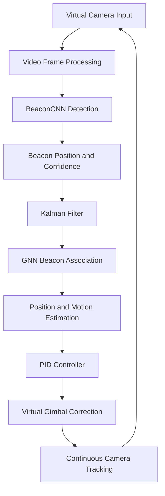

# 🚀 AURORA-PAT
### AI-Based Virtual Camera Tracking System for Coarse Alignment of Mobile Free-Space Optical Communication Terminals

AURORA-PAT is an AI-powered virtual tracking and alignment platform designed to improve coarse alignment of mobile Free-Space Optical Communication (FSOC) terminals.

The system combines deep learning, computer vision, Kalman filtering, Graph Neural Networks, and PID control to detect optical beacons, estimate their positions, predict movement, and continuously correct alignment through a virtual camera and gimbal simulation.

Instead of relying entirely on manual alignment, AURORA-PAT introduces an intelligent tracking pipeline that enables faster, more adaptive, and automated optical-terminal alignment.

<p align="center">

🚀 **[Live Demo](https://aurora-pat-frontend.onrender.com/)**

</p>

---

## 🎯 Problem Statement

Free-Space Optical Communication uses laser or optical beams to transmit data through free space.

However, maintaining accurate alignment between transmitting and receiving terminals is challenging, particularly when terminals are mounted on moving platforms.

Even small angular deviations can cause:

- Loss of optical signal.
- Reduced communication reliability.
- Increased acquisition time.
- Frequent manual realignment.
- Tracking difficulties under dynamic movement conditions.

Traditional alignment approaches can struggle to adapt to continuously changing terminal positions.

## 💡 Our Solution

AURORA-PAT introduces an AI-assisted virtual camera tracking system for intelligent coarse alignment of mobile FSOC terminals.

The platform combines multiple technologies into a unified tracking pipeline:

1. **Beacon Detection:** BeaconCNN detects and localizes optical beacons in camera frames.
2. **Position Estimation:** Extracts beacon coordinates and detection confidence.
3. **Motion Prediction:** Kalman filtering smooths tracking data and predicts beacon movement.
4. **Beacon Association:** Graph Neural Network-based association supports tracking across frames.
5. **Alignment Correction:** PID control calculates correction signals for virtual gimbal movement.
6. **Continuous Tracking:** The virtual camera updates its tracking position to maintain alignment.

---

## ⚡ System Workflow



**Core Concept:** Detect → Track → Predict → Correct → Align.

---

## 🌟 Key Features

### 1. AI-Based Beacon Detection
- BeaconCNN-based optical beacon detection.
- Position localization from video frames.
- Confidence-based detection output.
- Computer vision-powered tracking.

### 2. Intelligent Motion Tracking
- 4D Kalman filtering.
- Position estimation and motion prediction.
- Noise reduction and tracking stabilization.
- Continuous tracking across video frames.

### 3. Graph-Based Beacon Association
- GNN-based beacon association.
- Supports tracking consistency across frames.
- Helps associate detected beacons with existing tracks.

### 4. PID-Based Alignment Control
- Calculates alignment errors.
- Generates virtual gimbal correction signals.
- Supports continuous tracking adjustments.
- Reduces deviations between the target and tracking center.

### 5. Virtual Camera Simulation
- Simulates camera movement and tracking.
- Visualizes beacon position and movement.
- Provides virtual gimbal alignment behavior.
- Supports software-in-the-loop testing.

### 6. Dual Visualization
- Camera View for tracking and detection.
- World-FOV View for field-of-view visualization.
- Real-time tracking information.
- Integrated alignment monitoring.

### 7. Multiple Simulation Scenarios
- Supports seven existing simulation scenarios.
- Enables testing under different movement and alignment conditions.
- Allows comparison of tracking and alignment behavior.

---

## 🏗️ System Architecture

AURORA-PAT follows a full-stack architecture combining a Python-based backend with a React-based visualization interface.

### Technology Stack

| Component | Technology |
|---|---|
| Frontend | React |
| Frontend Build Tool | Vite |
| Backend | FastAPI |
| Programming Language | Python |
| AI Detection | BeaconCNN |
| Deep Learning Framework | PyTorch |
| Computer Vision | OpenCV |
| Motion Estimation | 4D Kalman Filter |
| Beacon Association | Graph Neural Network |
| Control System | PID Controller |
| Visualization | Virtual Camera and World-FOV |

### Architecture Overview

```text
                 AURORA-PAT
                      |
          +-----------+-----------+
          |                       |
       FRONTEND                 BACKEND
          |                       |
      React + Vite              FastAPI
          |                       |
     Dashboard UI           Tracking Pipeline
          |                       |
          |              +--------+--------+
          |              |        |        |
          |          BeaconCNN  Kalman    GNN
          |              |      Filter     |
          |              +--------+--------+
          |                       |
          |                  PID Control
          |                       |
          |                Virtual Gimbal
          |                       |
          +----------+------------+
                     |
             Live Tracking Output
                     |
            Camera / World-FOV View
```

---

## 📊 Simulation Results

AURORA-PAT has been evaluated through software-in-the-loop simulation.

Previously reported simulation results:

| Performance Metric | Result |
|---|---:|
| Processing Frame Rate | ~28 FPS |
| Acquisition Time | ~1 second |
| Overall Tracking Error | 18.07 pixels |
| Steady-State Tracking Error | 11.22 pixels |
| Overall Success Rate | 85.5% |
| Steady-State Success Rate | 95.3% |
| BeaconCNN Inference Latency | 13.78 ms |

**Note:** These are software simulation results, not measurements from physical FSOC hardware or a deployed optical communication terminal.

---

## 🚀 Getting Started

Follow these instructions to run AURORA-PAT locally.

### 1. Prerequisites

Install the following:

- Python 3.10+
- Node.js 20+
- npm
- Git

### 2. Backend Setup

Create a Python virtual environment:

```bash
python -m venv venv
```

Activate the environment.

**Windows:**

```powershell
.\venv\Scripts\Activate.ps1
```

**Linux/macOS:**

```bash
source venv/bin/activate
```

Install backend dependencies using the dependency installation instructions provided with the backend.

Start the FastAPI server:

```bash
uvicorn backend.main:app --reload --port 8000
```

Backend URL:

```text
http://localhost:8000
```

API Documentation:

```text
http://localhost:8000/docs
```

### 3. Frontend Setup

Open another terminal.

Navigate to the frontend directory and install dependencies:

```bash
cd frontend
npm install
```

Start the development server:

```bash
npm run dev
```

Open the frontend URL displayed in your terminal.

---

## 🧪 Testing & Verification

AURORA-PAT includes backend testing and frontend verification.

### Backend Tests

```bash
pytest backend/tests/ -v
```

Previously verified result:

**27/27 backend tests passed.**

### Frontend Type Checking

```bash
cd frontend
npx tsc --noEmit
```

Previously verified result:

**0 TypeScript errors.**

### Production Build

```bash
npm run build
```

Previously verified result:

**Production build completed successfully.**

---

## 🔬 Current Implementation & Future Scope

AURORA-PAT currently focuses on software-based simulation and virtual tracking.

### Implemented Capabilities
- AI-based beacon detection pipeline.
- Kalman-based tracking and prediction.
- GNN-based beacon association.
- PID-based virtual gimbal control.
- Virtual camera tracking.
- Camera and World-FOV visualization.
- Seven simulation scenarios.
- FastAPI backend and React frontend.

### Future Enhancements
- Physical camera integration.
- Real-time optical beacon acquisition.
- Hardware-based gimbal control.
- Integration with physical FSOC terminals.
- Real-world outdoor tracking validation.
- Communication performance evaluation under dynamic conditions.

---

## 🌍 Vision

AURORA-PAT aims to make optical-terminal alignment more intelligent, adaptive, and automated.

By combining AI-based detection, predictive tracking, and feedback control, the platform explores a smarter approach to maintaining alignment in mobile Free-Space Optical Communication systems.

**Detect intelligently. Predict movement. Align precisely.**


---

<p align="center">

**AURORA-PAT**

AI-Powered Virtual Tracking for Intelligent FSOC Alignment.

Built with ❤️ and intelligent engineering.

</p>
